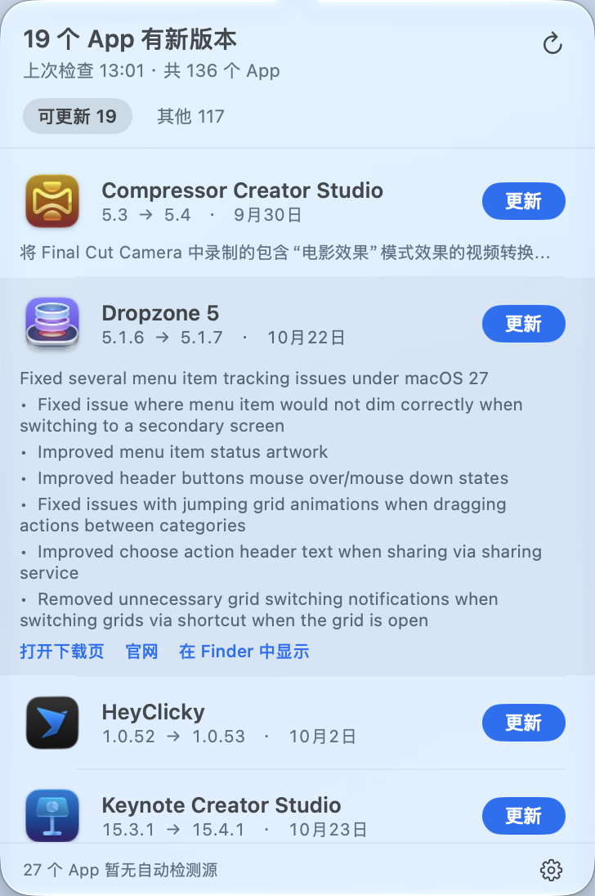

# 更新雷达（UpdateRadar）

一个常驻 macOS 菜单栏的小工具：扫一遍本机装的所有 App，把有新版本的挑出来，在菜单栏上显示一个数字。
点开面板就能看到「当前版本 → 新版本」和这次的更新说明，点「更新」直接去官方下载页 —— 装不装你说了算。

## 它能帮你解决什么

- 不用一个个打开 App、翻「关于」去查版本号，也不用等 App 自己良心发现来提醒你。
- 只提醒，不动手：不自动下载、不自动安装、不改你的 App。
- 没有更新源的 App 也老实列出来（标「无检测源」），不假装「已是最新」。

## 功能

- **菜单栏角标**：有 N 个新版本就显示 N（可以关掉，只留图标）。
- **左键点一行** → 就地展开这个 App 这次的更新说明；再点一下收起。
- **蓝色「更新」按钮** → 打开它的下载页（App Store 产品页 / 官网 dmg / GitHub Release）。
- **「其他」页签**看全部 App：已是最新、无检测源、检测失败、已忽略，支持搜索，分组可收起。
- **右键任意一行**：打开下载页、打开这个 App、在 Finder 中显示、这个已经是最新、忽略它。
- **系统通知**：发现新版本弹一条横幅，只在清单有变化时提醒一次，不会没完没了。
- **检查频率**：1 / 6 / 12 / 24 小时，关掉面板后继续在后台跑。
- **只提醒正式版**：默认不拿 Beta / RC 之类打扰你；想要尝鲜，面板齿轮里打开「接收测试版更新」。

## 下载安装

- **[下载最新版（Apple 芯片）](https://github.com/liaooabc/UpdateRadar/releases/latest)**
- 双击 dmg，把「更新雷达」拖进「应用程序」文件夹。
- 第一次打开会被系统拦一下（没上架商店、也没买开发者证书，只有临时签名）：
  在「应用程序」里 Control + 点图标 → 选「打开」→ 再点一次「打开」，只需一次。

**系统要求**：Apple 芯片（arm64），macOS 15 或更新。

## 常见问题

**为什么第一次打开要这么麻烦？**
因为没有每年 99 美元的苹果开发者证书，只能做临时签名，系统一律会拦。手动放行一次就正常了。

**会不会偷偷把我的 App 升级掉？**
不会。它只查、只提醒、只帮你打开官方下载页，装不装、什么时候装都由你点。

**某个 App 一直显示有新版（或数量不对）？**
点右上角刷新按钮重查一轮；还是不对，右键那一行选「这个已经是最新」，等它下次真的出新版会自己恢复提醒。

**为什么某个 App 明明发了新版却不提示？**
因为它发的是测试版（Beta / RC 之类）。更新雷达默认只跟正式版比，测试版不打扰你；
等正式版出来它自己会提示。想连测试版一起看，在面板右下角齿轮里勾「接收测试版更新」。

**会不会很占资源？**
常驻后台约 46 MB 内存、CPU 0.0%，一次检查的峰值约 77 MB，查完就回落。

## 想了解实现

检测原理、四层回退、性能数字、踩过的坑和别乱改的参数，都记在 [开发笔记.md](开发笔记.md)。
